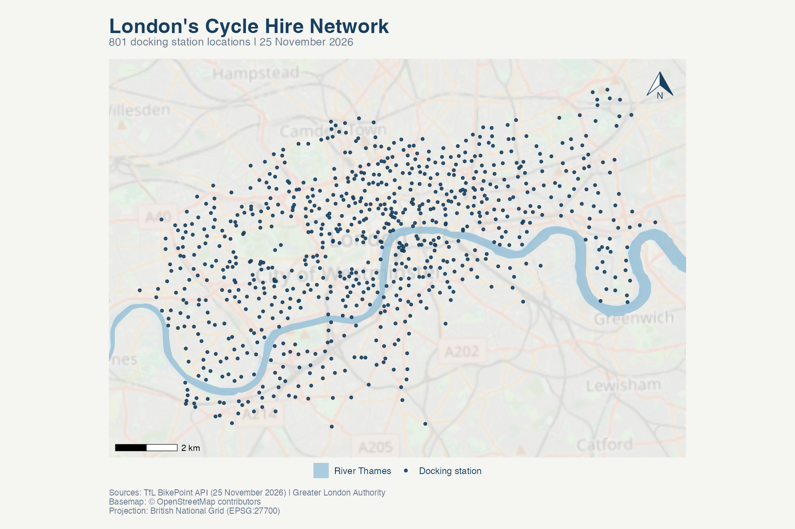

# Bridging London

**How does the Thames shape cycling connectivity?**

Mak Zie · MSc Geographic Data Science, LSE · November 2026  
[m.b.zie@lse.ac.uk](mailto:m.b.zie@lse.ac.uk)

This project combines Santander Cycles journey records with spatial analysis and modelled bicycle routes to investigate how geographical proximity translates into network connectivity. It explores how observed demand and route indirectness can inform further investigation by active travel planners.

**Interactive portfolio:** the website will be linked in the repository's About section once GitHub Pages is deployed.



## Key findings

| Observed mobility · March 2026 | Result |
|---|---:|
| Retained journeys | 715,689 |
| Journeys connecting opposite banks | 21.0% |

| Modelled connectivity · 30 sampled station pairs | Median detour ratio |
|---|---:|
| Cross-river (15 pairs) | **1.44×** |
| Same-bank (15 pairs) | **1.37×** |

Cross-river connections exhibited higher median detours in all three sampled distance bands. The largest difference occurred at 0.5–1 km. Temple Gardens–Waterloo Bridge had a modelled detour ratio of 2.07×, while Bonny Street–London Zoo reached 1.86× without crossing the river. The contrast illustrates why geographical proximity alone is insufficient for evaluating cycling connectivity.


**Detour ratio** = modelled cycling distance / straight-line distance between stations.

## Analytical workflow

| Source document | Method |
|---|---|
| [01 · Data preparation](01_data_prep.Rmd) | API acquisition, historical station matching, exclusions and directional journey aggregation |
| [02 · Spatial analysis](02_spatial_analysis.Rmd) | British National Grid (EPSG:27700), polygon difference, point-in-polygon classification, desire lines and station hubs |
| [03 · Network analysis](03_network_analysis.Rmd) | Stratified sampling, OSRM bicycle routing, endpoint snapping audits, crossing-count sensitivity and demand/detour screening |
| [04 · Portfolio](04_portfolio.Rmd) | R Markdown, ggplot2 and interactive Leaflet visualisation |

Selected outputs: [station distribution](outputs/station_bank_summary.csv) · [cross-river hubs](outputs/cross_river_station_hubs.csv) · [distance-band comparison](outputs/distance_band_comparison.csv) · [route quality](outputs/route_quality.csv) · [connection screening](outputs/sampled_connection_screen.csv).

## Reproduce locally

Open the repository as an RStudio project, with R, Pandoc and the required geospatial libraries installed. Install the R dependencies and initialise the local directories:

```r
install.packages(c("rmarkdown", "knitr", "httr", "jsonlite", "dplyr",
  "readr", "sf", "osrm", "ggplot2", "leaflet", "stplanr", "scales",
  "ggspatial", "ggrepel", "htmltools", "htmlwidgets"))
dir.create("data/raw/journeys", recursive = TRUE, showWarnings = FALSE)
dir.create("data/processed", recursive = TRUE, showWarnings = FALSE)
dir.create("outputs", recursive = TRUE, showWarnings = FALSE)
```

Download the two March 2026 TfL journey extracts into `data/raw/journeys/`. For exact replication, restore the original `data/raw/bikepoints.json`, `data/raw/thames.geojson`, `data/processed/routing_sample.rds` and cached route responses in `data/processed/route_cache/`. These are not included in the repository. Then render the four R Markdown documents in numerical order from the project root. Live routing is disabled by default in `03_network_analysis.Rmd`; missing or incompatible cached routes must be resolved before proceeding. The preparation script includes a live routing test. Avoid bulk requests to the public service.

The source code and published summaries support inspection, but exact numerical replication requires the original snapshots, route cache and compatible software. See [R session information](outputs/session_info.txt). The interactive basemap requires internet access.

## Data and limitations

- [TfL Santander Cycles journey archive](https://cycling.data.tfl.gov.uk/) — March 2026; [BikePoint API](https://api.tfl.gov.uk/BikePoint) — 25 November 2026 snapshot.
- [Greater London Authority Thames geometry](https://gis.london.gov.uk/arcgis/rest/services/apps/webmap_context_layer/MapServer/1/query?where=1%3D1&outFields=*&returnGeometry=true&outSR=4326&f=geojson) — November 2026 retrieval.
- [OpenStreetMap contributors](https://www.openstreetmap.org/copyright) and [OSRM bicycle routing](https://routing.openstreetmap.de/) — November 2026 routing results and street-map context.

The 30 modelled connections are exploratory, balanced by broad distance bands but not exactly matched by distance or neighbourhood. Historical journeys and station coordinates are temporally mismatched. Modelled routes do not reveal actual cyclist paths or establish causation. Demand/detour screening identifies candidates for investigation, not investment priorities.

Developed from the GY476 Applied Geographical Information Systems network-analysis workshop. Independent educational analysis, not an official TfL study.

Contains data provided by Transport for London. Map data © OpenStreetMap contributors. Third-party content remains subject to its terms: [TfL transport data](https://tfl.gov.uk/corporate/terms-and-conditions/transport-data-service), [OSM licensing](https://www.openstreetmap.org/copyright) and [tile usage](https://operations.osmfoundation.org/policies/tiles/). Verify GLA dataset-specific redistribution conditions before distribution. No separate software licence is asserted.
