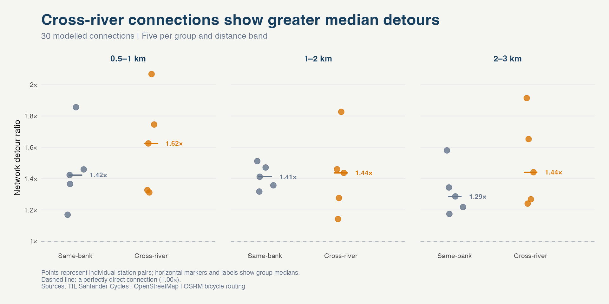

# Bridging London

**How does the Thames shape cycling connectivity?**

Mak Zie · MSc Geographic Data Science, London School of Economics and Political Science  
November 2026 · [m.b.zie@lse.ac.uk](mailto:m.b.zie@lse.ac.uk)

An independent spatial data science project investigating how geographical proximity translates into cycling connectivity in London's Santander Cycles network. Developed from the GY476 Applied Geographical Information Systems network-analysis workshop, it combines observed journey demand with modelled bicycle routes to explore where indirect connections may warrant further investigation by active travel planners.

**Explore the interactive portfolio:** open the GitHub Pages website linked in this repository's About section. The published page is generated from [`04_portfolio.Rmd`](04_portfolio.Rmd); its HTML entry point is `index.html`.

## Key findings

| Metric | Result |
|---|---:|
| Retained journeys, March 2026 | 715,689 |
| Journeys between opposite river banks | 21.0% |
| Docking station locations, November 2026 | 801 |
| Median modelled cross-river detour (15 routes) | 1.44× |
| Median modelled same-bank detour (15 routes) | 1.37× |

Cross-river connections had higher median detour ratios in all three sampled distance bands, with the largest difference in the 0.5–1 km band. A same-bank connection between Bonny Street and London Zoo also exhibited a substantial detour (1.86×), illustrating that the Thames is not the only potential barrier to direct cycling connectivity. The results are exploratory: the journey dataset describes observed station-to-station demand, whereas the detour estimates describe only 30 modelled connections, not all recorded journeys.



## Methodology

1. **Data preparation:** import March 2026 journey records, retrieve docking station and Thames geometries, match historical terminal identifiers, exclude unmatched or ambiguous station identifiers and same-station journeys, and aggregate directional origin–destination pairs.
2. **Spatial analysis:** project data into British National Grid (EPSG:27700); subtract the Thames polygon from the study area; validate river-bank classifications; calculate straight-line distances and map the 40 busiest bidirectional cross-river connections.
3. **Network analysis:** preserve a stratified sample of 30 distinct station pairs (five per relationship in each of the 0.5–1, 1–2 and 2–3 km bands); model cycling routes with OSRM; calculate network-to-direct distance ratios; audit endpoint snapping and river-bank transitions; explore contrasting high-detour routes and a sample-based demand/detour screening method.
4. **Communication:** assemble three static figures and a Leaflet route explorer into a self-contained HTML portfolio. The interactive basemap still requires internet access.

Detour ratio = modelled cycling distance / straight-line station separation. A ratio of 1.44 means the modelled distance is 44% longer than the direct separation.

## Repository structure

| File or directory | Purpose |
|---|---|
| [`01_data_prep.Rmd`](01_data_prep.Rmd) | Data acquisition, cleaning and station matching |
| [`02_spatial_analysis.Rmd`](02_spatial_analysis.Rmd) | River-bank classification, spatial summaries and Figures 1–2 |
| [`03_network_analysis.Rmd`](03_network_analysis.Rmd) | Routing, validation, case studies and Figures 3–4 |
| [`04_portfolio.Rmd`](04_portfolio.Rmd) | Public-facing presentation |
| `index.html` | Rendered portfolio, served by GitHub Pages |
| [`outputs/`](outputs/) | Selected analytical tables and web-resolution figures |
| `data/` (local only) | Raw data, processed spatial objects and cached routes |
| `.nojekyll` | Serve the pre-rendered site directly |

Selected evidence: [station distribution](outputs/station_bank_summary.csv), [directional flows](outputs/bank_flow_summary.csv), [cross-river station hubs](outputs/cross_river_station_hubs.csv), [distance-band comparison](outputs/distance_band_comparison.csv), [route quality](outputs/route_quality.csv) and [sampled demand/detour screening](outputs/sampled_connection_screen.csv).

## Data and attribution

| Source | Use | Date / coverage |
|---|---|---|
| [TfL Santander Cycles journey archive](https://cycling.data.tfl.gov.uk/) | Historical journey records | March 2026 |
| [TfL BikePoint API](https://api.tfl.gov.uk/BikePoint) | Docking station locations and identifiers | Snapshot: 25 November 2026 |
| [Greater London Authority Thames geometry](https://gis.london.gov.uk/arcgis/rest/services/apps/webmap_context_layer/MapServer/1/query?where=1%3D1&outFields=*&returnGeometry=true&outSR=4326&f=geojson) | River polygon for classification | Retrieved November 2026 |
| [OpenStreetMap contributors](https://www.openstreetmap.org/copyright) | Street-map context and routing data | Routing retrieved November 2026 |
| [OSRM bicycle routing service](https://routing.openstreetmap.de/) | Modelled distances, durations and route geometries | November 2026 |

Contains data provided by Transport for London. Map data © OpenStreetMap contributors. Third-party data and services remain subject to their respective terms, including [TfL transport data terms](https://tfl.gov.uk/corporate/terms-and-conditions/transport-data-service), [OSM attribution/licensing](https://www.openstreetmap.org/copyright) and the [OSM tile usage policy](https://operations.osmfoundation.org/policies/tiles/). The GLA source is credited; verify its dataset-specific redistribution terms before distributing the original geometry. This is an independent educational project, not an official TfL analysis.

## Reproducing the analysis

The rendered portfolio and selected summary outputs can be inspected without R. To rebuild locally, use R/RStudio with Pandoc (normally bundled with RStudio) and the following packages. `sf` may require system geospatial libraries on some platforms.

```r
install.packages(c(
  "rmarkdown", "knitr", "httr", "jsonlite", "dplyr", "readr",
  "sf", "osrm", "ggplot2", "leaflet", "stplanr", "scales",
  "ggspatial", "ggrepel", "htmltools", "htmlwidgets"
))
dir.create("data/raw/journeys", recursive = TRUE, showWarnings = FALSE)
dir.create("data/processed", recursive = TRUE, showWarnings = FALSE)
dir.create("outputs", recursive = TRUE, showWarnings = FALSE)
```

Place the two March 2026 extracts from the TfL archive in `data/raw/journeys/` (the 1–15 and 15–31 March extracts). For an exact reproduction of the original analysis, restore the original `data/raw/bikepoints.json`, `data/raw/thames.geojson`, `data/processed/routing_sample.rds` and the 30 cached `.rds` route responses in `data/processed/route_cache/`. These local files are intentionally not included in the public repository. The data-preparation document retrieves missing station and river snapshots and includes an OSRM test request; freshly retrieved data can differ from the original. The network document disables live routing by default and will stop if its cache is missing or incompatible. Do not send bulk requests to the public routing service.

Run from the project root, in order:

```r
rmarkdown::render("01_data_prep.Rmd")
rmarkdown::render("02_spatial_analysis.Rmd")
rmarkdown::render("03_network_analysis.Rmd")
rmarkdown::render("04_portfolio.Rmd")
```

The workflow uses fixed sampling seeds and cached route responses. Exact numerical replication requires the original snapshots, cache and a compatible R/package environment; these are not all bundled in this public release. A [`sessionInfo()` export](outputs/session_info.txt), if present, records the author's environment. A new retrieval is a new analysis, not a guaranteed replication of the published results.

## Limitations and practical relevance

- The 30-pair sample is balanced by broad distance bands, not exactly matched by distance or neighbourhood. Results are descriptive rather than causal or representative of the entire cycling network.
- Station coordinates were retrieved months after the journey period; matching and exclusions reduce but do not eliminate temporal mismatch.
- OSRM routes are modelled, not GPS traces. Route snapping, routing preferences and crossing-classification approximations introduce uncertainty. Actual bridge choice and travel behaviour cannot be inferred.
- High recorded demand combined with relatively indirect routes can identify candidates for further investigation within the sample, not investment priorities or estimates of latent demand.

## Author

**Mak Zie** · MSc Geographic Data Science, LSE  
[m.b.zie@lse.ac.uk](mailto:m.b.zie@lse.ac.uk)

Original analysis and presentation are shared for inspection as a portfolio project. No separate software licence is asserted here; third-party content retains its original terms.
